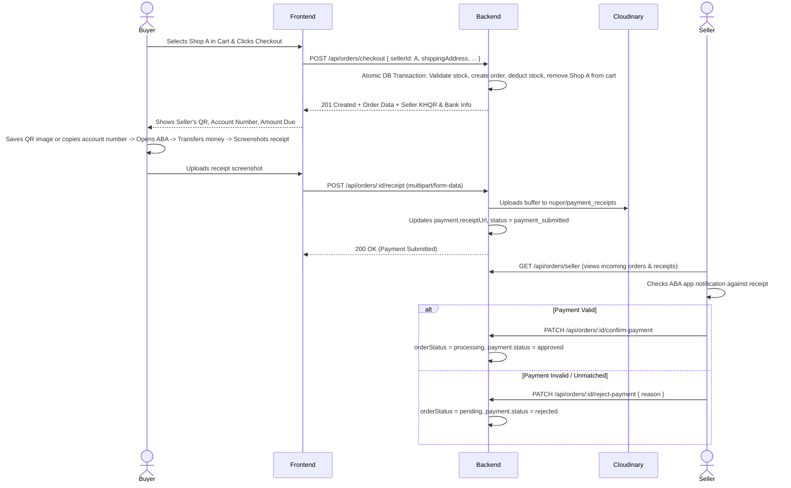

# Nupor Marketplace - Checkout & Payment Architecture

> **Context Document**: This document outlines the business rules, database schema, API endpoints, and mobile UX flow for the **Cart**, **Order**, and **Direct P2P Payment (Shopee Style)** system on Nupor Marketplace.

---

## 1. High-Level Concept: 1-Buyer-to-1-Seller Direct Payment

In Nupor Marketplace:
- The platform does **not** act as an escrow bank or collect all funds into a single centralized account.
- Instead, payments are **Direct Buyer-to-Seller (P2P)**.
- Every seller configures their personal **Bakong / ABA KHQR**, **Account Name**, and **Account Number** in their profile.
- When a buyer orders from a seller, the buyer transfers funds directly to that specific seller's bank account and uploads the payment receipt (screenshot) as proof.
- The seller verifies the receipt and approves the order.

---

## 2. Cart Architecture (Shopee Style)

A buyer can browse the marketplace and add products from multiple different sellers into a single cart.

### Cart Grouping (`GET /api/cart`)
The backend groups items by seller under a `shops` array:
```json
{
  "id": 1,
  "buyerId": 4,
  "totalItems": 3,
  "grandTotal": 4800.00,
  "shops": [
    {
      "sellerId": 3,
      "fullName": "Bong Lyheng",
      "userName": "bong_lyheng2",
      "profile_url": "https://cloudinary.com/profile.jpg",
      "khqrUrl": "https://cloudinary.com/seller3_khqr.png",
      "accountName": "BONG LYHENG",
      "accountNumber": "001 234 567",
      "subTotal": 1600.00,
      "totalItems": 1,
      "items": [
        {
          "id": 10,
          "productId": 4,
          "qty": 1,
          "subtotal": 1600.00,
          "product": { ... }
        }
      ]
    },
    {
      "sellerId": 4,
      "fullName": "Bong Lyheng Metfone",
      "userName": "bong_lyheng_metfone1",
      "subTotal": 3200.00,
      "totalItems": 2,
      "items": [ ... ]
    }
  ]
}
```

### Selective Checkout
- Checkout occurs **one seller at a time**.
- When the buyer clicks checkout on "Shop A", only items from Shop A are purchased and cleared from the cart.
- Items from Shop B remain in the buyer's cart for future checkout.

---

## 3. Database Schema

### `orders` Table
- `id` (PK, INTEGER)
- `buyerId` (INTEGER, FK -> `users.id`)
- `sellerId` (INTEGER, FK -> `users.id`)
- `orderNumber` (STRING, unique, e.g. `ORD-1789820524466`)
- `orderStatus` (STRING: `'pending'`, `'payment_submitted'`, `'processing'`, `'completed'`, `'cancelled'`)
- `totalAmount` (DECIMAL(10, 2))
- `shippingAddress` (TEXT)
- `receiverName` (STRING)
- `phoneNumber` (STRING)
- `createdAt`, `updatedAt`

### `orderItems` Table (Historical Snapshots)
- `id` (PK, INTEGER)
- `orderId` (INTEGER, FK -> `orders.id`, onDelete: CASCADE)
- `productId` (INTEGER, FK -> `products.id`, nullable, onDelete: SET NULL)
- `sellerId` (INTEGER, FK -> `users.id`)
- `productName` (STRING — snapshot of product name at purchase)
- `productImage` (STRING — snapshot of main image URL at purchase)
- `unitPrice` (DECIMAL(10, 2) — price snapshot)
- `qty` (INTEGER)
- `subTotal` (DECIMAL(10, 2))

### `payments` Table
- `id` (PK, INTEGER)
- `orderId` (INTEGER, FK -> `orders.id`, onDelete: CASCADE)
- `amount` (DECIMAL(10, 2))
- `status` (STRING: `'pending'`, `'payment_submitted'`, `'approved'`, `'rejected'`)
- `paymentMethod` (STRING: default `'khqr'`)
- `receiptUrl` (STRING, Cloudinary secure URL of transfer slip)
- `receiptPublicId` (STRING, Cloudinary public ID)
- `paidAt` (DATE)
- `remark` (TEXT)

### `user_profiles` Table (Seller Payment Info)
- `accountName` (STRING — e.g. "BONG LYHENG")
- `accountNumber` (STRING — e.g. "001 234 567")
- `khqrUrl` (STRING — Cloudinary URL of seller's KHQR image)
- `khqrPublic_id` (STRING)

---

## 4. End-to-End Order & Payment Flow



---

## 5. Mobile UX Flow for Cambodian Smartphone Users

When a buyer places an order on a smartphone:
1. **QR Display**: The app displays the seller's KHQR image.
2. **Action Buttons**:
   - **`[ 📥 Save QR Code ]`**: Saves the QR image directly to the phone's photo library.
   - **`[ 📋 Copy Account Number ]`**: Copies `accountNumber` to clipboard with toast notification.
   - **`[ 🚀 Open ABA Mobile ]`**: Deep links to `aba://` so the banking app launches directly.
3. **Payment Execution**:
   - In ABA Mobile, user taps **KHQR** -> taps **Photo Gallery** icon -> selects the saved QR photo.
   - User completes transfer and screenshots the bank receipt.
4. **Upload Proof**:
   - User returns to Nupor Marketplace and taps **`[ Upload Receipt Slip ]`**.

---

## 6. API Endpoints Reference

### Cart
- `GET /api/cart`
  - Returns cart items grouped by `shops` for Shopee-style display.
- `POST /api/cart/items`
  - Body: `{ productId, qty }`
- `PUT /api/cart/items/:productId`
  - Body: `{ qty }`
- `DELETE /api/cart/items/:productId`
- `DELETE /api/cart`

### Orders & Checkout
- `POST /api/orders/checkout`
  - Headers: `Authorization: Bearer <buyer_token>`
  - Body:
    ```json
    {
      "sellerId": 3,
      "shippingAddress": "St 2004, Toul Kork, Phnom Penh",
      "receiverName": "Sok San",
      "phoneNumber": "012345678",
      "paymentMethod": "khqr",
      "remark": "Call before delivery"
    }
    ```
  - Response: Created order + `sellerPaymentInfo` (`khqrUrl`, `accountName`, `accountNumber`, `amountDue`).

- `POST /api/orders/:id/receipt`
  - Headers: `Authorization: Bearer <buyer_token>`
  - Form-Data: `receipt: <File>`
  - Uploads screenshot to Cloudinary, updates `payments.receiptUrl` and status to `payment_submitted`.

- `PATCH /api/orders/:id/confirm-payment`
  - Headers: `Authorization: Bearer <seller_token>`
  - Approves payment (`payment.status = approved`, `orders.orderStatus = processing`).

- `PATCH /api/orders/:id/reject-payment`
  - Headers: `Authorization: Bearer <seller_token>`
  - Body: `{ "reason": "Amount does not match receipt" }`
  - Rejects payment (`payment.status = rejected`, `orders.orderStatus = pending`).

- `GET /api/orders/seller`
  - Headers: `Authorization: Bearer <seller_token>`
  - Returns all orders placed for the seller's shop.

- `GET /api/orders`
  - Headers: `Authorization: Bearer <buyer_token>`
  - Returns buyer's order history.

- `GET /api/orders/:id`
  - Headers: `Authorization: Bearer <token>`
  - Returns single order details (authorized for buyer, seller, or admin).

- `PATCH /api/orders/:id/status`
  - Headers: `Authorization: Bearer <token>`
  - Body: `{ "status": "cancelled" | "completed" }`
  - Note: If cancelled, product inventory stock is automatically restored.
