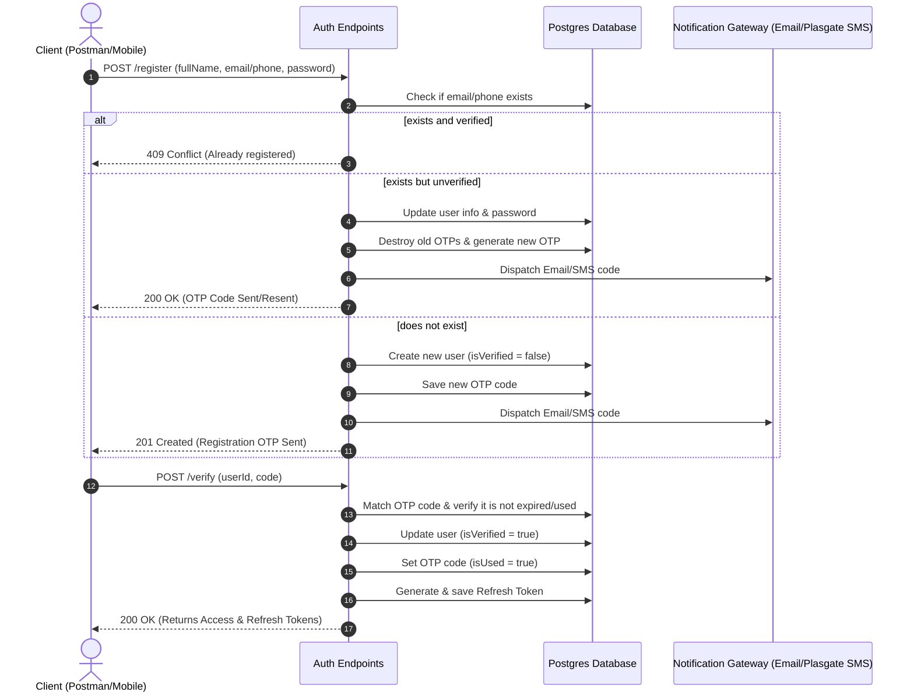

# Nupor Marketplace - Authentication Flows Documentation

This document describes the complete authentication flow for the **Nupor (នព្វ)** marketplace backend, including endpoints, parameters, and system behaviors.

---

## 1. Authentication Configuration

*   **Access Token**: Expires in **15 minutes** (payload includes user ID, role, and isSeller state).
*   **Refresh Token**: Expires in **7 days** (stored in the database, can be revoked).
*   **Password Reset Token**: Expires in **15 minutes** (dynamically signed using the user's password hash as the secret, making it single-use).
*   **OTP Codes**: Expire in **10 minutes** (for registration and password reset verification).

---

## 2. Mermaid Workflow Diagrams

### Registration and Verification Sequence


---

## 3. API Reference

### 3.1 Registration
Allows registering using either an `email` or a `phoneNumber` (at least one is required).

*   **URL**: `/api/v1/auth/register`
*   **Method**: `POST`
*   **Request Body (JSON)**:
    ```json
    {
      "fullName": "John Doe",
      "email": "john@example.com",
      "phoneNumber": "85512345678",
      "password": "SecurePassword123"
    }
    ```
*   **Response (201 Created)**:
    ```json
    {
      "message": "Register successfully. Please check your email for OTP verification.",
      "userId": 12
    }
    ```

---

### 3.2 Verification
Verifies the OTP code sent during registration.

*   **URL**: `/api/v1/auth/verify`
*   **Method**: `POST`
*   **Request Body (JSON)**:
    ```json
    {
      "userId": 12,
      "code": "1234"
    }
    ```
*   **Response (200 OK)**:
    ```json
    {
      "result": {
        "message": "Verify Otp code successfully!",
        "refreshToken": "eyJhbGciOi...",
        "accessToken": "eyJhbGciOi..."
      }
    }
    ```

---

### 3.3 Resend OTP
Resends a new verification code if the previous one expired.

*   **URL**: `/api/v1/auth/resend-otpcode`
*   **Method**: `POST`
*   **Request Body (JSON)**:
    ```json
    {
      "userId": 12
    }
    ```
*   **Response (200 OK)**:
    ```json
    {
      "result": {
        "message": "OTP sent successfully! Please check your email."
      }
    }
    ```

---

### 3.4 Login
Supports logging in using either `email` or `phoneNumber`.

*   **URL**: `/api/v1/auth/login`
*   **Method**: `POST`
*   **Request Body (JSON)**:
    ```json
    {
      "email": "john@example.com",
      "password": "SecurePassword123"
    }
    ```
*   **Response (200 OK)**:
    ```json
    {
      "result": {
        "message": "Login Successfully!",
        "accessToken": "eyJhbGciOi...",
        "refreshToken": "eyJhbGciOi..."
      }
    }
    ```

---

### 3.5 Refresh Token
Requests a new access token when the old one expires.

*   **URL**: `/api/v1/auth/refreshtoken`
*   **Method**: `POST`
*   **Request Body (JSON)**:
    ```json
    {
      "refreshToken": "eyJhbGciOi..."
    }
    ```
*   **Response (200 OK)**:
    ```json
    {
      "result": {
        "accessToken": "eyJhbGciOi..."
      }
    }
    ```

---

### 3.6 Forgot Password
Sends a dynamic verification code to reset the password.

*   **URL**: `/api/v1/auth/forgot-password`
*   **Method**: `POST`
*   **Request Body (JSON)**:
    ```json
    {
      "email": "john@example.com"
    }
    ```
*   **Response (200 OK)**:
    ```json
    {
      "result": {
        "message": "If that account exists, an OTP has been sent successfully."
      }
    }
    ```

---

### 3.7 Verify Forgot Password OTP
Verifies the forgot password code and returns a short-lived `resetToken`.

*   **URL**: `/api/v1/auth/verify-forgot-otp`
*   **Method**: `POST`
*   **Request Body (JSON)**:
    ```json
    {
      "email": "john@example.com",
      "code": "5678"
    }
    ```
*   **Response (200 OK)**:
    ```json
    {
      "result": {
        "message": "OTP verified successfully. You can now reset your password.",
        "resetToken": "eyJhbGciOi..."
      }
    }
    ```

---

### 3.8 Reset Password
Resets the user's password using the temporary `resetToken`.

*   **URL**: `/api/v1/auth/reset-password`
*   **Method**: `POST`
*   **Request Body (JSON)**:
    ```json
    {
      "resetToken": "eyJhbGciOi...",
      "newPassword": "MyNewSecurePassword123"
    }
    ```
*   **Response (200 OK)**:
    ```json
    {
      "result": {
        "message": "Reset password successfully! Please login again",
        "accessToken": "eyJhbGciOi..."
      }
    }
    ```

---

### 3.9 Change Password (Authenticated)
Changes the logged-in user's password and revokes all active device sessions.

*   **Headers**: `Authorization: Bearer <accessToken>`
*   **URL**: `/api/v1/auth/change-password`
*   **Method**: `POST`
*   **Request Body (JSON)**:
    ```json
    {
      "currentPassword": "SecurePassword123",
      "newPassword": "MyNewSecurePassword123"
    }
    ```
*   **Response (200 OK)**:
    ```json
    {
      "result": {
        "message": "Update password successfully, please log in again!"
      }
    }
    ```

---

## 4. SMS Gateway Integration (Plasgate)

When an OTP or password reset is triggered for a phone number:
1.  The backend calls `sendSms(phoneNumber, message)`.
2.  If `PLASGATE_PRIVATE_KEY` and `PLASGATE_SECRET_KEY` are provided in `.env`, the utility submits a POST request to `https://cloudapi.plasgate.com/rest/send?private_key=...` with header `X-Secret`.
3.  If they are not defined, it writes a mock SMS output to the server console log for painless local development.
